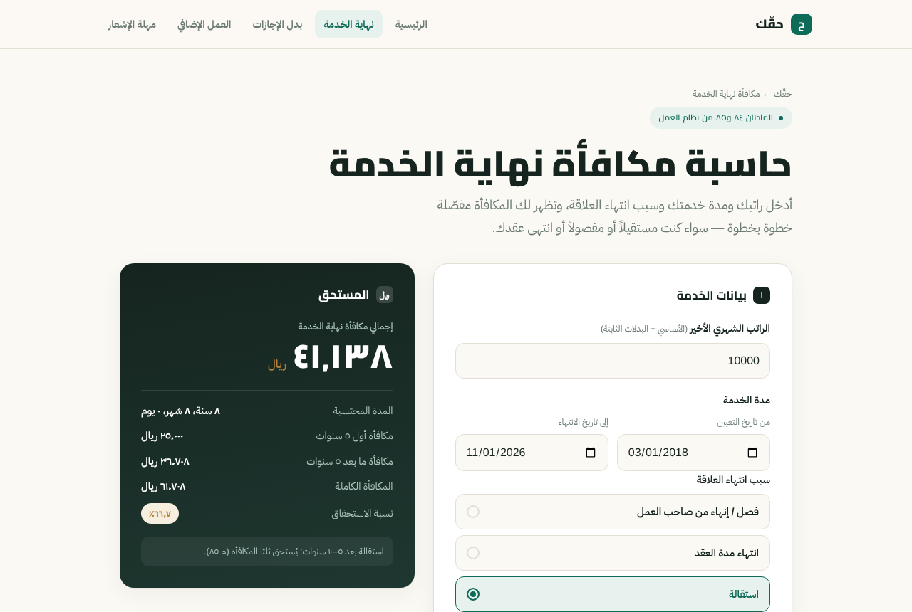
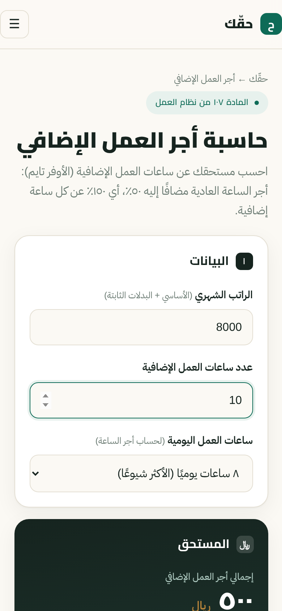

# ⚖️ حقّك (Haqak): Saudi Labor Law Calculators


**▶ Live: [inspiring-halva-d196f9.netlify.app](https://inspiring-halva-d196f9.netlify.app/)**

Haqak is an Arabic website with free calculators for employee rights under the **Saudi Labor Law**. Each result comes with a step-by-step breakdown and an explanation of the article it is based on. Everything runs in the browser, so no salary or date ever leaves the user's device.



## 🧮 Calculators

| Calculator | Legal basis | What it handles |
|---|---|---|
| **End-of-service award** (مكافأة نهاية الخدمة) | Articles 84 & 85 | Half a month per year for the first 5 years, a full month per year after that; resignation tiers (0, ⅓, ⅔, full); exceptions for fixed-term contracts and for a female employee resigning after marriage or childbirth; exact Y/M/D service length |
| **Annual leave pay** (بدل الإجازة السنوية) | Article 109 | Daily wage × unused days; entitlement of 21 or 30 days depending on tenure |
| **Overtime pay** (أجر العمل الإضافي) | Article 107 | Hourly wage × 150% |
| **Notice period pay** (بدل مهلة الإشعار) | Article 75 | 60 days (employer), 30 days (worker), 30 days for non-monthly wages |

## 🛠️ How it's built

- **Static site**: plain HTML, CSS and JavaScript with **no frameworks and no build step**, hosted on Netlify.
- **Logic separated from UI**: all formulas live in [`calc.js`](calc.js) as pure functions. The pages use them in the browser, and the tests import the same file in Node.
- **Unit tested**: 9 tests cover each formula, the Article 85 tier boundaries (exactly 2, 5 and 10 years), the exceptions, and edge cases in date math such as 31 January + 1 month.
- **Arabic-first UX**: right-to-left layout, Arabic-Indic digits with the Arabic thousands separator, Cairo and IBM Plex Sans Arabic fonts, and a mobile-first design.
- **SEO**: one page per calculator with explanatory content and FAQs, canonical URLs, `sitemap.xml`, `robots.txt`, internal linking between related calculators, and Google Search Console verification.
- **Privacy**: no backend, no cookies, no tracking of inputs.

<p align="center"></p>

## 🧪 Tests

```bash
npm test     # node --test, no dependencies to install
```

## 🚀 Run locally

```bash
git clone https://github.com/Moleo10/haqak.git
cd haqak
python -m http.server 8000      # open http://localhost:8000
```

## 🗺️ Roadmap

- [ ] Net salary after GOSI (social insurance) deductions, handling both the old and new contribution rules
- [ ] English version
- [ ] Shareable result links

---

> ⚠️ Results are a guide based on the general rules of the Saudi Labor Law. The official reference is the Ministry of Human Resources and the Qiwa platform.

Built by **Mohammed Saqer Almutairi** · [LinkedIn](https://www.linkedin.com/in/m-saqer-almutairi)
